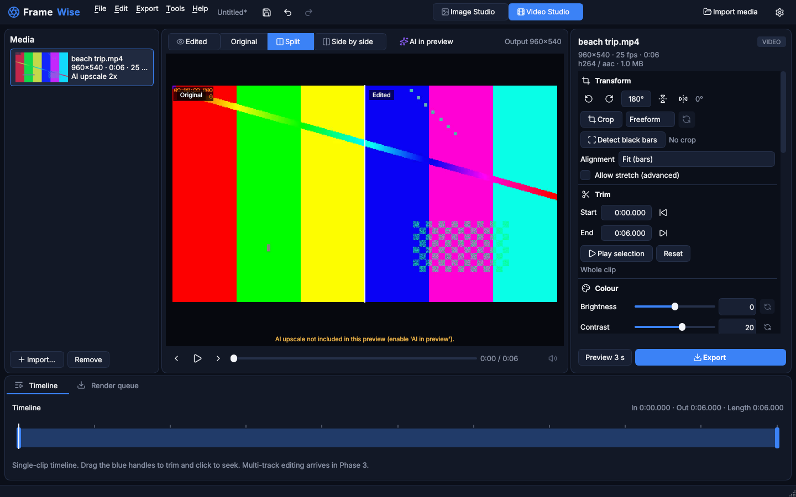

# FrameWise

**Make old, low-resolution or shaky videos look good: on your own PC, with your own GPU, without uploading anything.**

Free video editors make you choose between simple trimming tools and AI enhancement, and AI enhancement usually means
a cloud service with upload limits, subscriptions and privacy trade-offs, or command-line tools that need CUDA, PyTorch
and a lot of patience. FrameWise puts AI enhancement and everyday editing in one desktop app that runs entirely locally
on any NVIDIA, AMD or Intel GPU.



## What works today (v0.1, Phase 1)

- **Media library:** import or drag in videos, with thumbnails, resolution, frame rate, duration and codecs.
- **Built-in player:** play, scrub and step frame by frame.
- **AI upscaling** with Real-ESRGAN, with presets for general footage, live action, anime (fast or quality) and game or
  screen recordings. Targets: 2×, 3×, 4×, 1080p, 1440p or 4K. The app shows the exact output size before you render.
- **Render queue:** runs in the background with progress, time left, cancel and retry. A 3-second preview button lets you
  compare settings before committing to a long render.
- **Crash-safe AI renders:** video is processed in chunks, so disk use stays small and a cancelled or crashed render
  resumes from the last finished chunk.
- **Projects:** save and reopen your work (`.fwproj`), with undo and redo for every edit. Projects from older
  versions of FrameWise are upgraded automatically when opened, and the original file is only changed when you save.
- **Hardware encoders:** NVIDIA NVENC, AMD AMF and Intel QSV are detected automatically and only shown when they work.
- **First-run setup** downloads ffmpeg and the AI engine for you. Original audio is always kept.
- **Feature check:** FrameWise asks your ffmpeg which filters it has and shows, under *Tools → Download / check
  tools*, which editing features are available, unavailable or limited. A render never pretends a missing
  filter worked; it stops with a plain explanation.

### Phase 2 in progress
The render engine now supports frame-exact **trim**, **rotate/flip**, **crop** (applied before AI upscaling) and
**speed changes** (0.25×–4×, audio pitch kept and in sync), identically in normal exports and chunked AI upscales.
The editing controls for these arrive in the next steps.

## Roadmap

| Phase | Scope |
|---|---|
| 1 ✅ | Foundation: library, player, projects, undo, render queue, AI upscaling |
| 2 | Single-clip tools: trim, crop (manual and auto black bars), rotate, denoise, deinterlace, stabilize, colour, speed, audio, export presets, compress to a target size |
| 3 | Timeline editor: multiple tracks, split and arrange clips, transitions, music track |
| 4 | Text and subtitles: titles, watermark, SRT burn-in, auto-captions with Whisper |
| 5 | AI tools: smart reframe (landscape to 9:16), RIFE frame interpolation, scene detection, silence removal |
| 6 | Release: Windows installer, settings page, GPU auto-configuration |

## Run it

**Windows:** install [Python 3.10+](https://www.python.org/downloads/) (tick *Add to PATH*), then double-click `run.bat`.
The first launch creates a virtual environment and installs dependencies; after that it starts straight away.

**Any OS:**
```bash
python -m venv .venv
.venv/bin/pip install -e .          # Windows: .venv\Scripts\pip install -e .
.venv/bin/python -m framewise       # Windows: .venv\Scripts\pythonw -m framewise
```
On Linux and macOS, install ffmpeg with your package manager. On Windows the app downloads it for you.

Logs: `%LOCALAPPDATA%\FrameWise\logs` (Windows) or `~/.local/share/FrameWise/logs` (Linux), also reachable via *Tools → Open logs folder*.

## Development

```bash
pip install -e ".[dev]"
pytest
```
Tests run without a GPU: a stand-in upscaler resizes frames with ffmpeg, so the full pipeline, the render queue and the
UI (offscreen Qt) are exercised end to end. CI runs on Ubuntu and Windows for every push.

### Architecture

```
src/framewise/
  core/      errors, paths, settings, logging, cancellable subprocesses       (no Qt)
  media/     ffprobe → MediaInfo, thumbnails                                  (no Qt)
  tools/     locate / download ffmpeg + AI engines, encoder detection         (no Qt)
  project/   data model, .fwproj save/load, undo stack, ProjectDocument       (no Qt)
  render/    filter graph builder, presets, scaling maths, RenderSpec, pipeline, queue   (no Qt)
  ui/        PySide6 widgets: they show state and forward user intent, nothing else
```
Everything below `ui/` is plain Python and unit-tested on its own. Every project edit goes through `ProjectDocument` as
an undoable command, and the UI updates from the document's events. New features plug in as render steps and inspector
sections rather than special cases.

`render/graph.py` turns a clip's edit into one `RenderPlan`: the filter chain, split at the AI-upscaling boundary,
plus exact frame windows and audio filters. Both render paths and (from Step 3) the preview read the same plan, so
they cannot drift apart. Tests check it pixel by pixel with real ffmpeg: a marker block for geometry, frames that
encode their own index for trim and speed, and a timed tone for audio sync and pitch.

## Credits
[ffmpeg](https://ffmpeg.org) · [Real-ESRGAN](https://github.com/xinntao/Real-ESRGAN) (ncnn-vulkan build) · [Qt for Python](https://doc.qt.io/qtforpython/)
